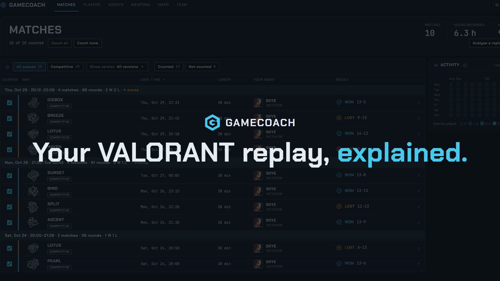
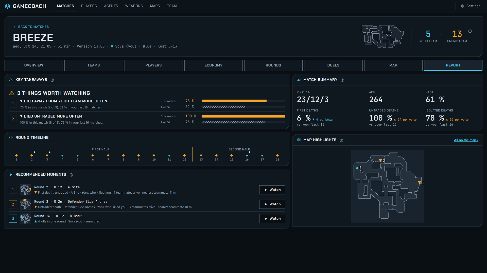
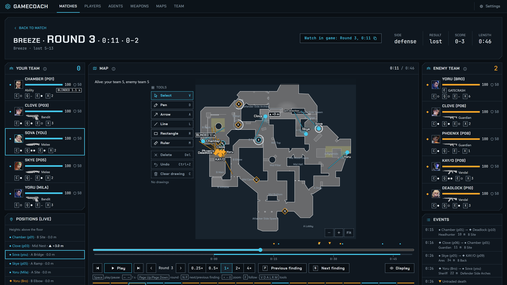
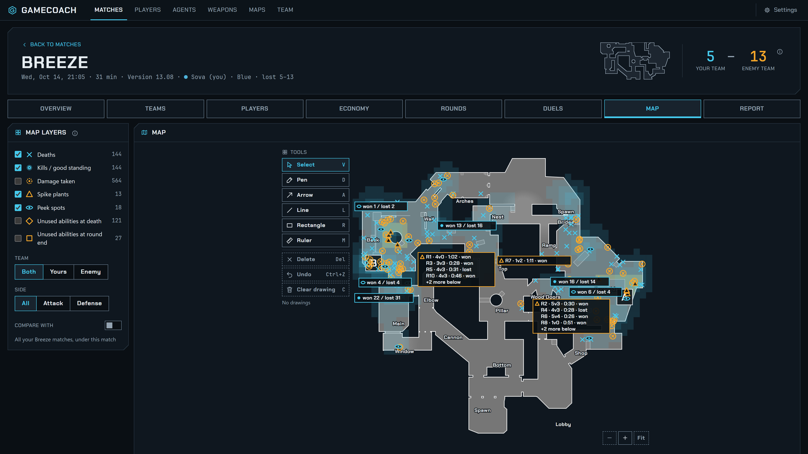
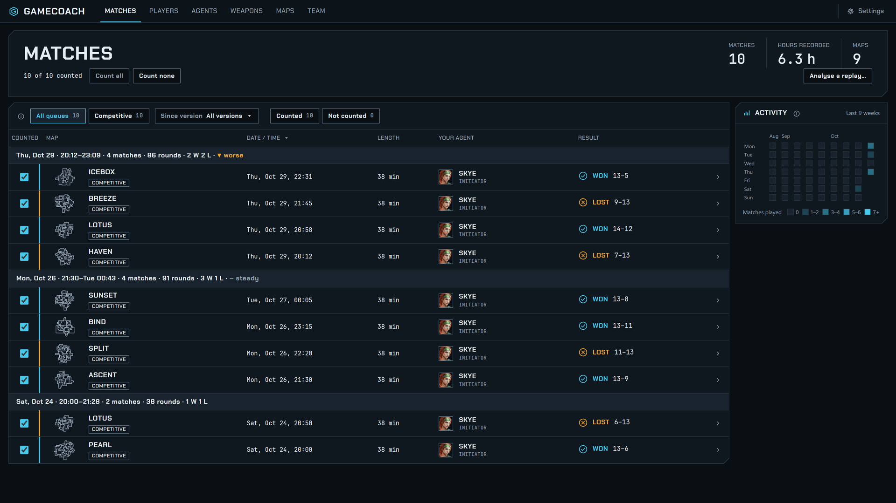

# GameCoach

A VALORANT coach for Windows. GameCoach reads the replays VALORANT saves on your PC, plays every round back on a
2D map and tells you the one thing to fix next: measured from your own matches, compared with the rest of the lobby.

**[Download the latest version](https://github.com/da2ky/gamecoach-releases/releases/latest)**: run
`GameCoach.App-win-Setup.exe` from the release's assets. GameCoach updates itself after that.

**▶ [Watch the 48-second teaser](docs/gamecoach-teaser.mp4)**

## What it does

- **Match review.** Every round at a glance, the one thing to fix in this match, what you already do well, and the
  moments worth rewatching (each with a jump straight to that second).
- **Round replay on the map.** All ten players with health, armor, weapon and ability charges; play, pause, step,
  slow motion, drawing tools and a ruler.
- **Dashboard over many matches.** Impact, trading, opening duels, economy, aim and spray, rounds won and the trend
  per map, each against your own earlier matches and against the lobby. A focus of the week picked from your
  most frequent mistake.
- **Agents, weapons, maps.** Abilities, synergies and counters with their sources, pro picks per map, lore.
- **English and German**, dark and light theme, full keyboard and screen-reader support.

## Screenshots

**Match report:** the things worth watching, the round timeline and the moments to rewatch.

**Round replay:** all ten players on the map with health, armor, weapon, abilities and status effects; drawing tools and the events list.

**Match map:** deaths, kills, spike plants and peek spots of the whole match as layers.

**Matches:** your replays grouped by session, with the result and your agent.

The screenshots and the teaser show a sample match; player names are changed.

## Requirements

- Windows 10 or 11, 64-bit
- VALORANT with replays saved on the same PC (GameCoach reads `%LOCALAPPDATA%\VALORANT\Saved\Demos`)

## Your data

Your matches stay on your PC. GameCoach analyses the replay files locally and stores the results locally. It goes
online only to check for updates (this repository) and to download map pictures.

## Updates

Installed GameCoach checks this repository at start and once a day; turn it off under Settings > Updates. A new
version installs when you restart or close the app. The changes of each version are in its release notes.

## Questions and bugs

Open an [issue](https://github.com/da2ky/gamecoach-releases/issues). Please add the version from Settings > About and,
for a crash, the log file `%LOCALAPPDATA%\GameCoach\gamecoach.log`. This repository holds only the installers; the
source code is not public.

---

GameCoach isn't endorsed by Riot Games and doesn't reflect the views or opinions of Riot Games or anyone officially
involved in producing or managing Riot Games properties. Riot Games and all associated properties are trademarks or
registered trademarks of Riot Games, Inc.

Replay parsing by [ValorantReplayParser](https://github.com/michel-giehl/ValorantReplayParser) (MIT).
